# Система бронирования мастер-классов
 
Учебный проект по дисциплине **«Создание программного обеспечения»**.
 
Веб-приложение для записи на мастер-классы: мастера публикуют занятия, клиенты бронируют места, администратор модерирует каталог.
 
## Команда

| Участник | Роль |
|----------|------|
| Беляева Анна Павловна | Тимлид\ Аналитик |
| Кайзер Даниил Дмитриевич | Фронтенд-разработчик |
| Славгородский Сергей Романович | Тестировщик |
| Ичкеева Софья Мингияновна | Бэкенд-разработчик |

## Содержание
 
- [1. Предметная область](#1-предметная-область)
- [2. Методология](#2-методология)
- [3. Технологический стек](#3-технологический-стек)
- [4. Ролевая модель](#4-ролевая-модель)
- [5. Диаграмма прецедентов](#5-диаграмма-прецедентов)
- [6. Диаграмма классов](#6-диаграмма-классов)
- [7. Бизнес-логика](#7-бизнес-логика)
- [8. Экраны приложения](#8-экраны-приложения)
- [9. Фронтенд](#9-фронтенд)
---
 
## 1. Предметная область
 
Система помогает организовать запись на практические занятия: кулинарные, творческие, ремесленные и другие мастер-классы.
 
**Зачем это нужно:**
 
- клиенты видят все доступные мастер-классы в одном месте и записываются без звонков и переписок;
- мастера публикуют свои занятия и знают, сколько человек придёт;
- администратор следит за качеством каталога и порядком в системе;
- нет перебронирования: мест ровно столько, сколько указал мастер;
- остаётся история записей, отмен и отзывов.
**Как это работает:**
 
1. Пользователь регистрируется сам, выбирая роль клиента или мастера.
2. Администратор подтверждает мастера, после чего тот может публиковать мастер-классы.
3. Мастер создаёт мастер-класс (тема, категория, описание, место, дата и время, цена, число мест) и отправляет на модерацию.
4. Администратор одобряет мастер-класс или отклоняет его с указанием причины.
5. Одобренный мастер-класс появляется в каталоге, клиент бронирует место. Оплата проходит на месте, на сайте оплаты нет.
6. Если мест нет, клиент встаёт в лист ожидания; при отмене чьей-то брони место автоматически переходит первому в очереди.
7. Если мастеру нужно перенести или изменить опубликованный мастер-класс, он подаёт запрос, и изменение вступает в силу только после подтверждения администратором.
8. После проведения мастер-класса клиент оставляет отзыв и оценку, из них складывается рейтинг мастера.
## 2. Методология
 
- **Разработка:** Agile/Scrum — работаем по спринтам, регулярно показываем результат.
- **Моделирование:** OOAD — строим UML-диаграммы перед тем, как писать код.
- **Сбор требований:** Use Case Driven — отталкиваемся от того, что должен уметь делать пользователь.
## 3. Технологический стек
 
| Компонент | Технология |
|-----------|------------|
| Backend | Python + FastAPI |
| База данных | PostgreSQL |
| Frontend | JS + React |
| Аутентификация | JWT-токены + хеширование паролей (bcrypt) |
| Ролевая модель | Три роли: `client` / `master` / `admin` |
| Запуск | Docker + docker-compose |
 
## 4. Ролевая модель
 
Все пользователи регистрируются самостоятельно и выбирают роль «клиент» или «мастер». Роль администратора через регистрацию получить нельзя: первый администратор создаётся при инициализации базы данных. Каталог опубликованных мастер-классов можно просматривать и без входа в систему, но для бронирования и любых действий нужна авторизация.
 
### Клиент (client)
 
Человек, который хочет записаться на мастер-класс.
 
**Может:**
 
- смотреть каталог опубликованных мастер-классов, искать и фильтровать их (по категории, дате, цене, мастеру);
- смотреть профили мастеров и отзывы о них;
- бронировать место на мастер-классе;
- вставать в лист ожидания, если мест нет;
- отменять свою бронь (не позднее чем за 24 часа до начала);
- смотреть список своих записей и их статусы;
- оставлять отзыв и оценку после посещённого мастер-класса;
- редактировать свой профиль.
**Не может:**
 
- создавать и редактировать мастер-классы;
- видеть списки участников и чужие записи;
- бронировать место на уже прошедшем или отменённом мастер-классе;
- записаться на один и тот же мастер-класс дважды.
### Мастер (master)
 
Человек, который проводит мастер-классы.
 
**Может:**
 
- смотреть каталог, искать, смотреть профили и отзывы;
- создавать мастер-классы и свободно редактировать свои черновики (после подтверждения мастера администратором);
- отправлять мастер-класс на модерацию и исправлять отклонённые;
- подавать запрос на изменение или перенос опубликованного мастер-класса не позднее чем за 24 часа до начала (изменение вступает в силу после подтверждения администратором);
- смотреть список участников и лист ожидания своих мастер-классов;
- смотреть свой рейтинг и отзывы о себе;
- редактировать свой профиль (о себе, контакты).
**Не может:**
 
- бронировать места (для этого нужна отдельная учётная запись клиента);
- публиковать мастер-класс без одобрения администратора;
- вносить изменения в опубликованный мастер-класс напрямую, без подтверждения администратором;
- отменять мастер-классы (только переносить);
- редактировать чужие мастер-классы;
- влиять на отзывы о себе: ни скрывать, ни удалять их.
### Администратор (admin)
 
Модератор и ответственный за работу системы.
 
**Может:**
 
- смотреть каталог, профили и отзывы;
- подтверждать учётные записи мастеров;
- одобрять мастер-классы или отклонять их с указанием причины;
- рассматривать запросы мастеров на изменение и перенос мастер-классов (подтверждать или отклонять);
- отменять любые мастер-классы;
- смотреть списки участников любых мастер-классов;
- вести справочник категорий;
- скрывать неприемлемые отзывы;
- смотреть журнал действий: кто, когда и что делал.
**Не может:**
 
- бронировать места и оставлять отзывы;
- редактировать содержание мастер-классов мастеров (только одобрить, отклонить или отменить);
- физически удалять мастер-классы, брони, отзывы и пользователей (только отмена и скрытие);
- менять собственную роль.
### Матрица доступа к операциям
 
| Операция | Клиент | Мастер | Администратор |
|----------|:------:|:------:|:-------------:|
| Просмотр каталога опубликованных мастер-классов | ✅ | ✅ | ✅ |
| Поиск и фильтрация мастер-классов | ✅ | ✅ | ✅ |
| Просмотр профиля мастера и отзывов о нём | ✅ | ✅ | ✅ |
| Редактирование своего профиля | ✅ | ✅ | ✅ |
| Бронирование места | ✅ | ❌ | ❌ |
| Запись в лист ожидания | ✅ | ❌ | ❌ |
| Отмена своей брони | ✅ | ❌ | ❌ |
| Просмотр своих записей | ✅ | ❌ | ❌ |
| Оставление отзыва и оценки | ✅ | ❌ | ❌ |
| Создание мастер-класса | ❌ | ✅ (после подтверждения) | ❌ |
| Редактирование черновика и отклонённого мастер-класса | ❌ | ✅ (только своих) | ❌ |
| Отправка мастер-класса на модерацию | ❌ | ✅ (только своих) | ❌ |
| Запрос на изменение или перенос опубликованного мастер-класса | ❌ | ✅ (только своих) | ❌ |
| Просмотр неопубликованных мастер-классов | ❌ | ✅ (только своих) | ✅ (всех) |
| Просмотр списка участников | ❌ | ✅ (только своих) | ✅ (всех) |
| Отмена мастер-класса | ❌ | ❌ | ✅ |
| Модерация мастер-классов (одобрить / отклонить) | ❌ | ❌ | ✅ |
| Рассмотрение запросов на изменение и перенос | ❌ | ❌ | ✅ |
| Подтверждение мастеров | ❌ | ❌ | ✅ |
| Управление категориями | ❌ | ❌ | ✅ |
| Скрытие отзывов | ❌ | ❌ | ✅ |
| Просмотр журнала действий | ❌ | ❌ | ✅ |
 
## 5. Диаграмма прецедентов


 
**Акторы:**
 
- клиент — записывается на мастер-классы и оставляет отзывы;
- мастер — создаёт и проводит мастер-классы;
- администратор — модерирует контент и подтверждает изменения.
Все три актора обобщаются актором «Пользователь», который объединяет общие действия.
 
**Прецеденты:**
 
- *Доступны всем ролям:* регистрация, вход, просмотр каталога, поиск и фильтрация, просмотр профиля мастера и отзывов, редактирование своего профиля.
- *Только клиент:* бронирование места (при отсутствии мест расширяется прецедентом «Запись в лист ожидания»); отмена своей брони; просмотр своих записей; оставление отзыва и оценки.
- *Только мастер:* создание мастер-класса и редактирование черновика (включает отправку на модерацию); запрос на изменение или перенос опубликованного мастер-класса; просмотр списка участников; просмотр своих мастер-классов и рейтинга.
- *Только администратор:* модерация мастер-классов; подтверждение мастеров; управление категориями; рассмотрение запросов на изменение мастер-классов; скрытие отзывов; просмотр журнала действий; отмена любого мастер-класса.


 
## 6. Диаграмма классов
 
Диаграмма отражает структуру базы данных и основные сущности backend-части.
 
**Основные классы:**
 
- **User** — пользователь системы.
  - Атрибуты: `id`, `email`, `first_name`, `last_name`, `phone`, `password_hash`, `role` (enum: `client`/`master`/`admin`), `is_approved` (подтверждён ли мастер; для клиентов и администраторов `true`), `bio` (описание мастера), `created_at`.
  - Методы: `register()`, `login()`, `logout()`, `getRating()` (средний рейтинг мастера по видимым отзывам).
- **Category** — категория мастер-классов (кулинария, керамика, живопись и т.д.).
  - Атрибуты: `id`, `name`, `description`.
- **Workshop** — мастер-класс.
  - Атрибуты: `id`, `master_id`, `category_id`, `title`, `description`, `location`, `start_at`, `duration_min`, `price` (только для информации, оплата на месте), `capacity` (число мест), `status` (enum: `draft`/`pending`/`published`/`rejected`/`cancelled`/`finished`), `reject_reason`, `created_at`, `updated_at`.
  - Методы: `submitForModeration()`, `requestChange()`, `cancel()` (только администратор), `getFreeSeats()`.
- **Booking** — запись клиента на мастер-класс.
  - Атрибуты: `id`, `workshop_id`, `client_id`, `status` (enum: `confirmed`/`waitlisted`/`cancelled`), `created_at`, `cancelled_at`.
  - Методы: `cancel()`, `promoteFromWaitlist()`.
- **Review** — отзыв клиента о мастер-классе.
  - Атрибуты: `id`, `booking_id`, `workshop_id`, `client_id`, `rating` (1–5), `comment`, `is_hidden`, `created_at`.
- **WorkshopChangeRequest** — запрос мастера на изменение или перенос опубликованного мастер-класса.
  - Атрибуты: `id`, `workshop_id`, `requested_by` (мастер), `changes` (JSON с новыми значениями полей, в том числе новой датой и временем), `status` (enum: `pending`/`approved`/`rejected`/`expired`), `reject_reason`, `reviewed_by` (администратор), `created_at`, `reviewed_at`.
  - Методы: `approve()`, `reject()`.
- **ActionLog** — журнал действий.
  - Атрибуты: `id`, `user_id`, `entity_type` (enum: `workshop`/`change_request`/`booking`/`user`/`review`/`category`), `entity_id`, `action` (enum: `created`/`updated`/`deleted`/`approved`/`rejected`/`cancelled`), `details`, `created_at`.
**Связи:**
 
- `User → Workshop`: один мастер ведёт много мастер-классов (через `master_id`);
- `Category → Workshop`: в одной категории много мастер-классов, у мастер-класса одна категория;
- `Workshop → Booking`: на мастер-класс приходит много записей;
- `User → Booking`: один клиент делает много записей (через `client_id`);
- `Booking → Review`: к записи относится не более одного отзыва;
- `User → Review`: один клиент пишет много отзывов;
- `Workshop → WorkshopChangeRequest`: на один мастер-класс может быть много запросов на изменение, но открытый (`pending`) только один;
- `User → WorkshopChangeRequest`: мастер подаёт запросы (`requested_by`), администратор их рассматривает (`reviewed_by`);
- `User → ActionLog`: один пользователь порождает много записей в журнале.


 
## 7. Бизнес-логика
 
- **Регистрация и подтверждение мастера.** При регистрации пользователь выбирает роль. Клиент сразу получает полный доступ. Мастер получает учётную запись с `is_approved = false`: он может войти, заполнить профиль и создавать черновики, но не может отправлять мастер-классы на модерацию, пока администратор не подтвердит его.
- **Статусы мастер-класса:**
  - `draft` — черновик, виден только мастеру;
  - `pending` — отправлен на модерацию, ждёт решения администратора;
  - `published` — одобрен, виден в каталоге, открыт для бронирования;
  - `rejected` — отклонён администратором, указана причина; мастер может исправить и отправить снова;
  - `cancelled` — отменён администратором, все брони аннулированы;
  - `finished` — проведён (время начала и длительность прошли), доступны отзывы.
  Переходы: `draft → pending → published` или `rejected`; `rejected → pending` (после исправления); `published → cancelled`; `published → finished` (автоматически по времени). Из `cancelled` и `finished` переходов нет.
- **Изменение и перенос.** Пока мастер-класс в статусе `draft` или `rejected`, мастер правит его свободно. После публикации любое изменение (перенос на другие дату и время, смена места, цены, описания, числа мест) делается только через запрос на изменение (`WorkshopChangeRequest`). Мастер указывает новые значения; пока администратор не принял решение, в каталоге действуют прежние. Запрос можно подать только на опубликованный мастер-класс, не позднее чем за 24 часа до его начала, и только один открытый запрос на мастер-класс одновременно. Администратор подтверждает запрос (новые значения применяются) или отклоняет его с указанием причины. Если до начала мастер-класса решения нет, запрос получает статус `expired` и не применяется. Число мест нельзя уменьшить ниже количества подтверждённых броней.
- **Последствия переноса.** При подтверждённом переносе действующие брони сохраняются, в разделе «Мои записи» мастер-класс помечается как перенесённый. Освободившиеся места занимает лист ожидания как обычно.
- **Бронирование.** Забронировать можно только опубликованный мастер-класс, который ещё не начался. Клиент не может иметь две активные брони на один мастер-класс. Если свободные места есть, бронь получает статус `confirmed`. Если мест нет, клиенту предлагается лист ожидания, бронь получает статус `waitlisted`.
- **Защита от перебронирования.** Свободные места считаются как `capacity` минус число броней со статусом `confirmed`. Проверка и создание брони выполняются в одной транзакции с блокировкой строки мастер-класса (`SELECT … FOR UPDATE`), поэтому два клиента не займут последнее место одновременно.
- **Статусы брони:**
  - `confirmed` — место закреплено за клиентом;
  - `waitlisted` — клиент в листе ожидания, место не закреплено;
  - `cancelled` — бронь отменена клиентом или из-за отмены мастер-класса.
- **Отмена брони клиентом.** Клиент может отменить подтверждённую бронь не позднее чем за 24 часа до начала. Из листа ожидания можно выйти в любой момент до начала. После начала мастер-класса отмена невозможна.
- **Лист ожидания.** Очередь строится по времени создания брони (`created_at`): первым пришёл — первым получил место. Когда подтверждённая бронь отменяется или число мест увеличивается, система в той же транзакции переводит первого из очереди в `confirmed`. Это действие записывается в журнал.
- **Отмена мастер-класса.** Мастер не может отменить мастер-класс, он может только запросить перенос. Отменить мастер-класс может только администратор: статус меняется на `cancelled`, все активные брони (`confirmed` и `waitlisted`) переходят в `cancelled`. Отменить уже прошедший мастер-класс нельзя.
- **Отзывы и рейтинг.** Отзыв можно оставить только на мастер-класс со статусом `finished` и только при наличии подтверждённой брони; на одну бронь — один отзыв. Оценка от 1 до 5, комментарий необязателен. Рейтинг мастера — среднее значение оценок по всем его мастер-классам, скрытые отзывы в расчёт не входят. Мастер не может скрывать отзывы о себе; скрыть отзыв (`is_hidden = true`) может только администратор.
- **Оплата.** Оплата проходит на месте, у мастера. В системе нет платежей, статусов оплаты и онлайн-касс; цена в карточке мастер-класса указана для информации.
- **Аудит.** Каждое значимое действие (создание, изменение, одобрение, отклонение, отмена, запрос на изменение, скрытие отзыва) записывается в `ActionLog` с указанием, кто (`user_id`) и когда (`created_at`). Журнал доступен только администратору.
- **Удаление.** Физического удаления мастер-классов, броней, отзывов и пользователей через интерфейс нет. Мастер-класс отменяют (только администратор), отзыв скрывают. Так сохраняется вся история. Категорию с привязанными мастер-классами удалить нельзя.
- **Безопасность.** Пароли хранятся только в виде хешей bcrypt, минимальная длина пароля — 8 символов. Права проверяются на сервере в каждом запросе по роли из JWT-токена, а скрытие кнопок на фронтенде служит только удобством.

## 8. Экраны приложения

Ниже приведены общие экраны и экраны каждой из ролей. Различия между ролями на каждом экране соответствуют матрице доступа (раздел 4). Опасные действия (отмена брони, отклонение и отмена мастер-класса, блокировка пользователя, удаление категории) всегда подтверждаются модальным окном, результат любого действия показывается всплывающим уведомлением (тостом), пустые списки сопровождаются подсказками-заглушками.

Сводная таблица доступа к экранам:

| Экран | Без входа | Клиент | Мастер | Администратор |
| --- | --- | --- | --- | --- |
| Каталог мастер-классов | просмотр и поиск | просмотр и поиск | просмотр и поиск | просмотр и поиск |
| Карточка мастер-класса | просмотр | + бронирование, лист ожидания, отзыв | просмотр | просмотр |
| Профиль мастера | просмотр | просмотр | просмотр | просмотр |
| Вход и регистрация | ✅ | ✅ | ✅ | ✅ |
| Мои записи | ❌ | ✅ | ❌ | ❌ |
| Профиль | ❌ | ✅ | ✅ | ✅ |
| Мои мастер-классы | ❌ | ❌ | ✅ | ❌ |
| Создание / редактирование мастер-класса | ❌ | ❌ | ✅ | ❌ |
| Участники мастер-класса | ❌ | ❌ | ✅ (своих) | ❌ |
| Админ-панель (5 вкладок) | ❌ | ❌ | ❌ | ✅ |

Состав шапки зависит от роли: всем доступен «Каталог»; клиенту — «Мои записи»; мастеру — «Мои мастер-классы»; администратору — «Админ-панель». Авторизованным пользователям дополнительно доступны «Профиль» и «Выйти», неавторизованным — «Войти».

### 8.1. Вход

Форма входа: поля «Email» и «Пароль», ссылка на страницу регистрации. Экран одинаков для всех; после входа система определяет роль пользователя и открывает соответствующий набор разделов. Если сессия истекла (API ответил 401), пользователь перенаправляется сюда с предупреждением о необходимости войти заново.

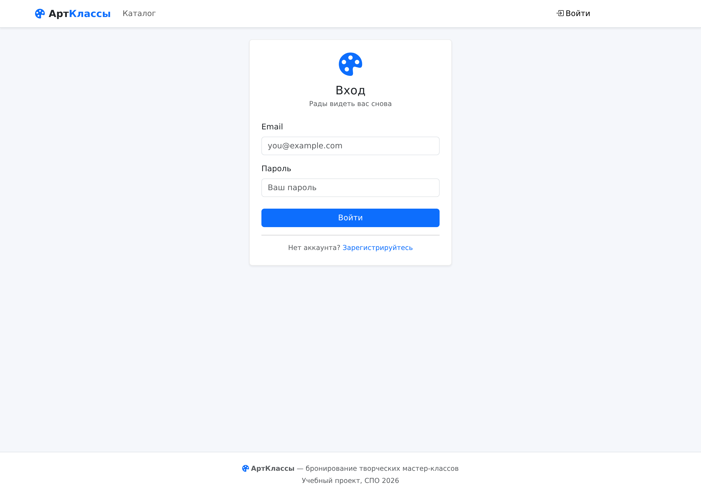

### 8.2. Регистрация

Форма: имя, фамилия, email, телефон (необязательно), пароль (минимум 8 символов) и выбор роли — «Клиент» или «Мастер». Клиент после регистрации сразу получает полный доступ к бронированию; мастер может войти и создавать черновики, но отправлять мастер-классы на модерацию сможет только после подтверждения администратором (раздел 7).

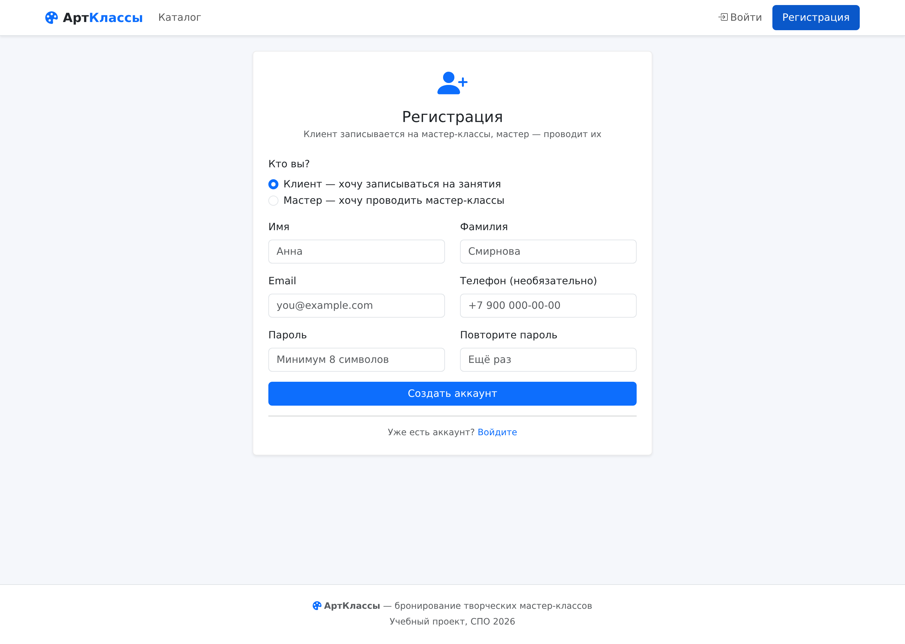

### 8.3. Каталог мастер-классов

Главный экран — сетка карточек опубликованных мастер-классов. На карточке: бейдж категории, название, краткое описание, дата и время, длительность, место, имя мастера, цена и число свободных мест. Слева — панель фильтров: поиск по названию и описанию, категория, диапазон дат (вводится в формате дд.мм.гггг), флажок «Только со свободными местами», кнопки «Применить» и «Сбросить». Под списком — пагинация. Каталог доступен без входа в систему.

*Различия ролей:* каталог одинаков для всех ролей; само бронирование выполняется из карточки мастер-класса и доступно только клиенту.

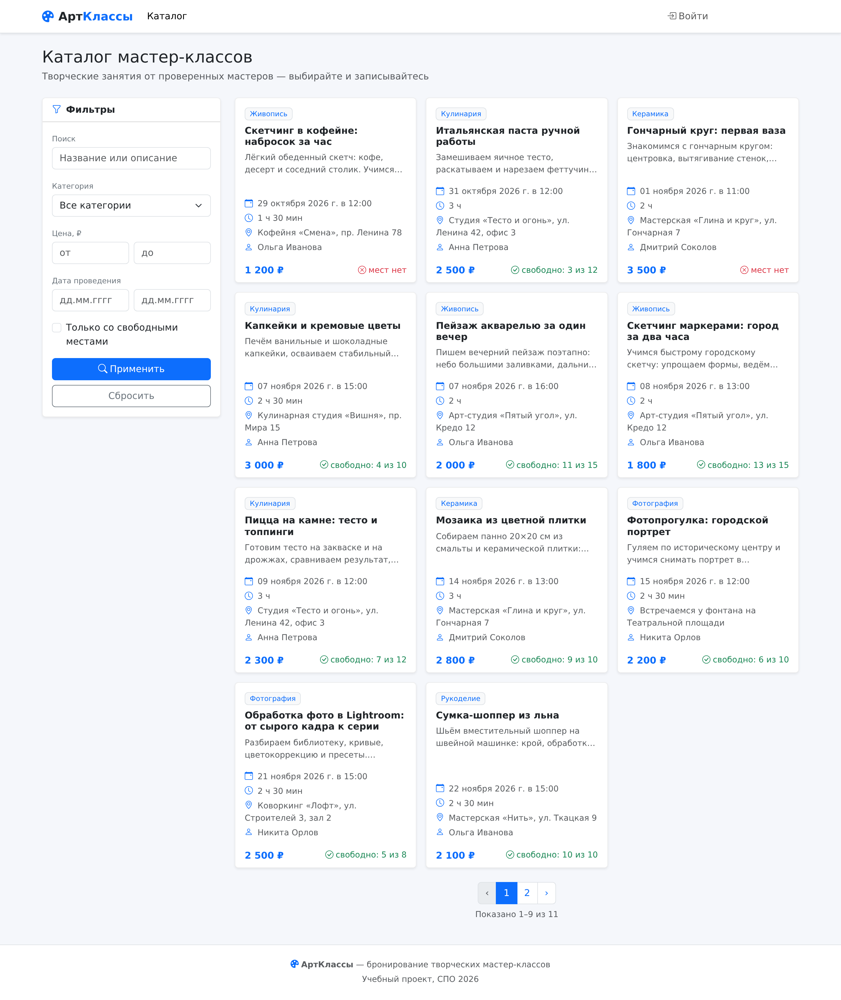

### 8.4. Карточка мастер-класса

Полная информация о занятии: категория, название, подробное описание, дата и время, длительность, место, мастер (ссылка на его профиль), цена, свободные места, статус. Ниже — отзывы: средний рейтинг звёздами и список отзывов клиентов.

*Различия ролей (по матрице доступа):* клиенту доступно бронирование, а при отсутствии свободных мест — кнопка «Записаться в лист ожидания»; если мастер-класс завершён и у клиента была подтверждённая бронь, в разделе «Мои записи» появляется кнопка «Оставить отзыв» — модальная форма с оценкой от 1 до 5 (см. 8.6). Мастер и администратор видят карточку без кнопок бронирования (мастеру бронировать запрещено ролевой моделью). Неопубликованные мастер-классы посторонним недоступны: их видят только мастер-владелец и администратор.

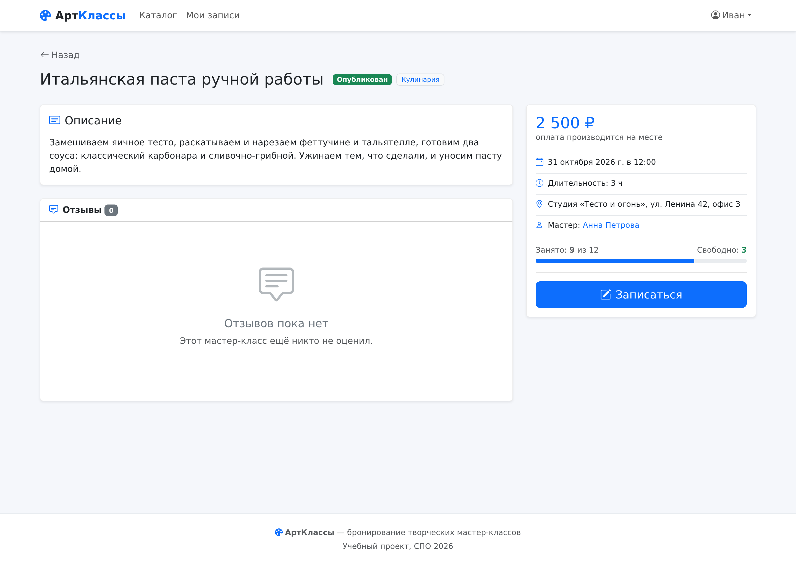

### 8.5. Профиль мастера

Публичная страница мастера: ФИО, «о себе», контакты, средний рейтинг и отзывы о нём. Кнопка «Смотреть каталог» открывает каталог, отфильтрованный по мастер-классам этого мастера. Страница доступна всем посетителям, включая неавторизованных. Мастер не может влиять на отзывы о себе: ни скрывать, ни удалять их.

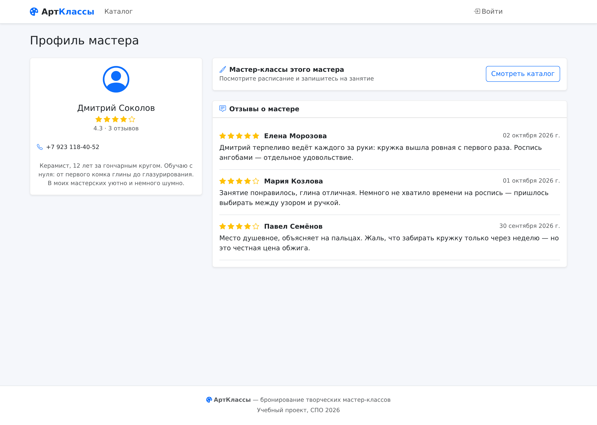

### 8.6. Мои записи (клиент)

Список броней клиента с фильтром по статусу; каждая запись показывает мастер-класс, дату и статус-бейдж («Подтверждена», «Лист ожидания», «Отменена»). Подтверждённую бронь можно отменить не позднее чем за 24 часа до начала — ближе к началу кнопка отмены скрывается. Из листа ожидания можно выйти в любой момент до начала занятия. Отмена выполняется через модальное окно «Отменить бронь?».

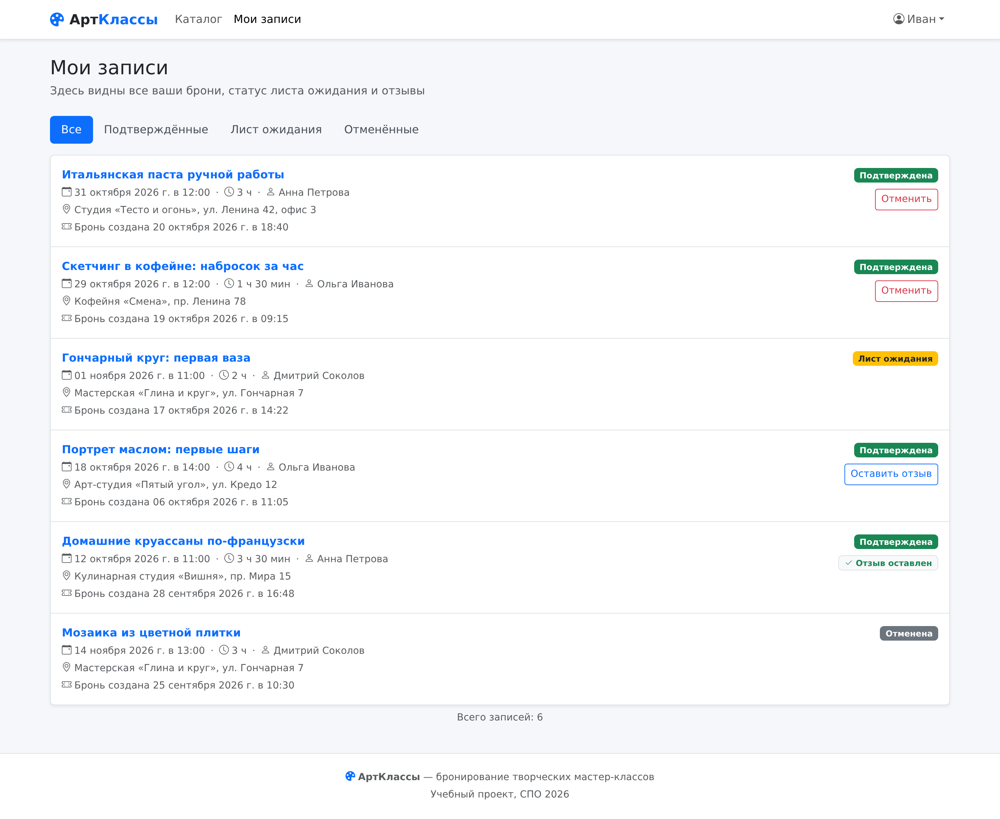

### 8.7. Профиль

Редактирование собственных данных: имя, фамилия, телефон. Мастер дополнительно заполняет «О себе» — с пометкой «видно клиентам». Экран доступен всем авторизованным ролям.

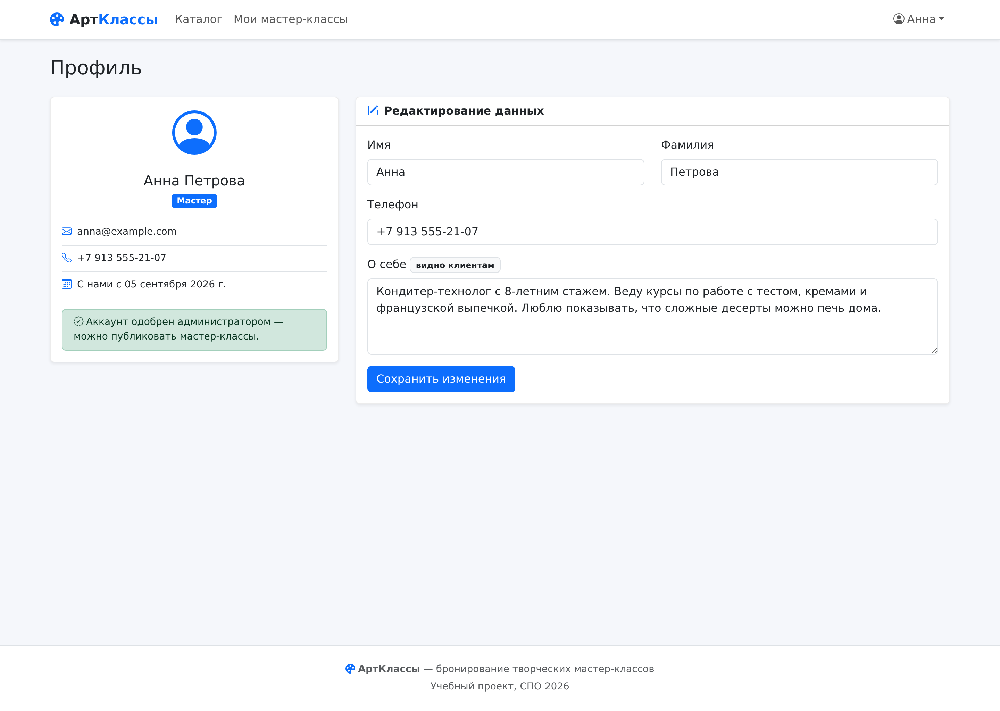

### 8.8. Мои мастер-классы (мастер)

Кабинет мастера: список собственных мастер-классов с фильтром по статусу и статус-бейджами. Действия: отправить на модерацию (с подтверждением), отредактировать, открыть участников. У отклонённых мастер-классов показывается причина — мастер может исправить работу и отправить на модерацию заново. Пока мастер не подтверждён администратором, в шапке кабинета висит плашка «ожидает одобрения», а отправка на модерацию недоступна. Вверху — кнопка «Создать мастер-класс».

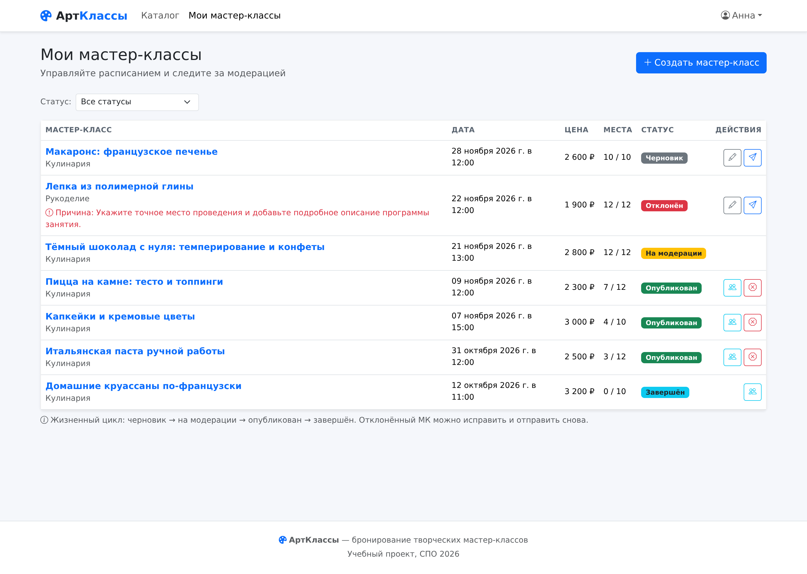

### 8.9. Создание и редактирование мастер-класса (мастер)

Форма: категория, название, описание, место, дата (дд.мм.гггг) и время (чч:мм), длительность, цена, число мест. Кнопка «Создать черновик» сохраняет работу; отправка на модерацию выполняется из списка «Мои мастер-классы». Черновики и отклонённые мастер-классы редактируются свободно; изменение опубликованных согласовывается с администратором через запрос на изменение (раздел 7).

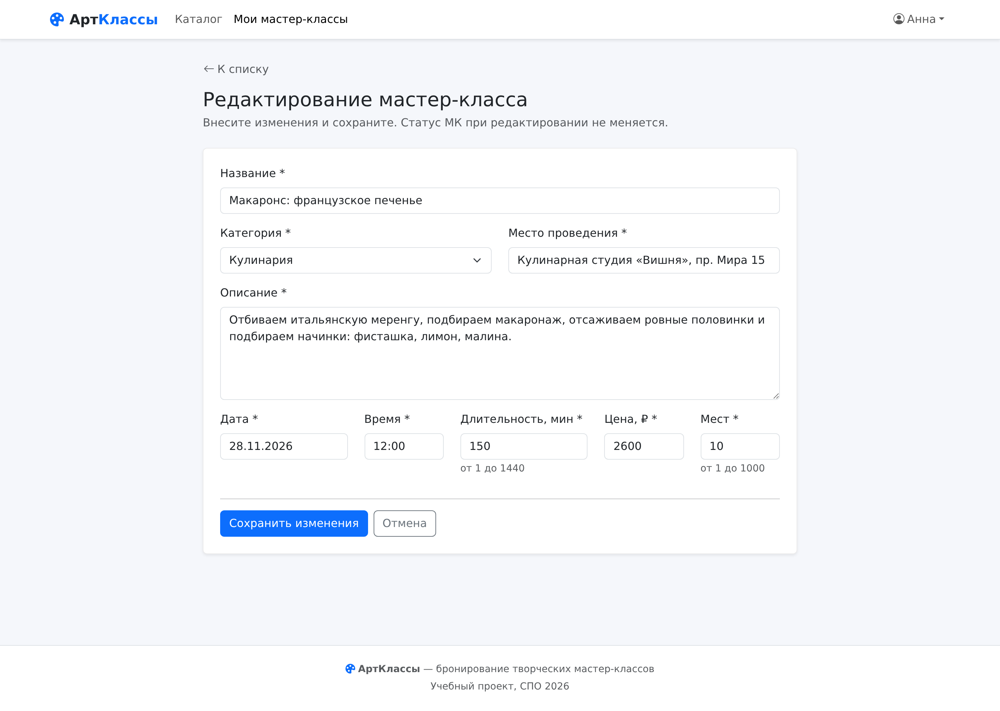

### 8.10. Участники мастер-класса (мастер)

Списки подтверждённых участников и листа ожидания со счётчиками; очередь листа ожидания строится по времени записи. Экран доступен мастеру только для собственных мастер-классов.

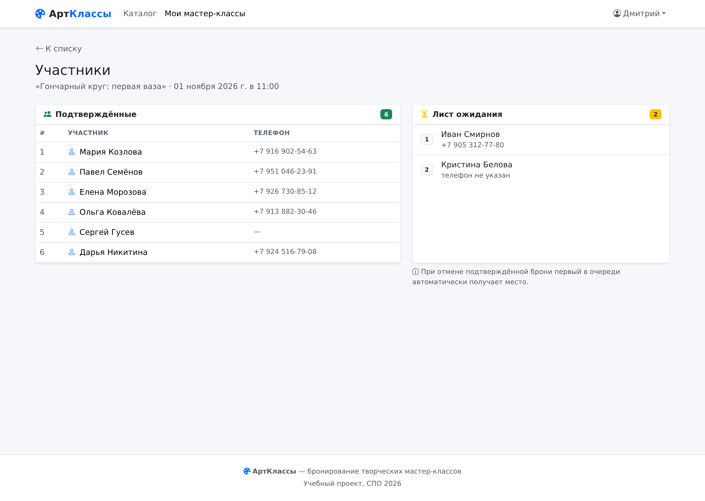

### 8.11. Админ-панель: вкладка «Мастер-классы»

Таблица всех мастер-классов системы с фильтром по статусу. Действия: «Одобрить» (с подтверждением «Одобрить и опубликовать»), «Отклонить» — с обязательным указанием причины (мастер увидит её в своём кабинете), «Отменить МК» — отмена с аннулированием всех активных броней.

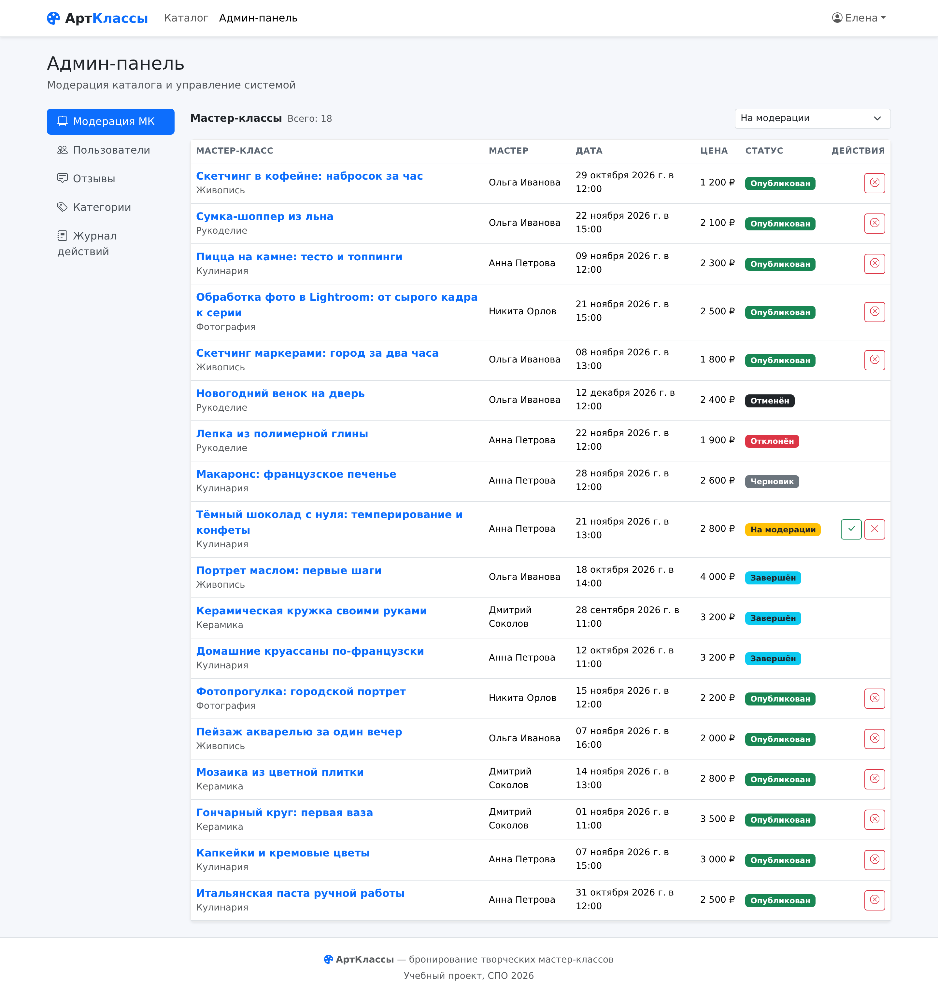

### 8.12. Админ-панель: вкладка «Пользователи»

Управление учётными записями: поиск и фильтры по роли, подтверждённости и активности. Действия: подтвердить мастера, заблокировать и разблокировать пользователя (обе операции — через модальное подтверждение).

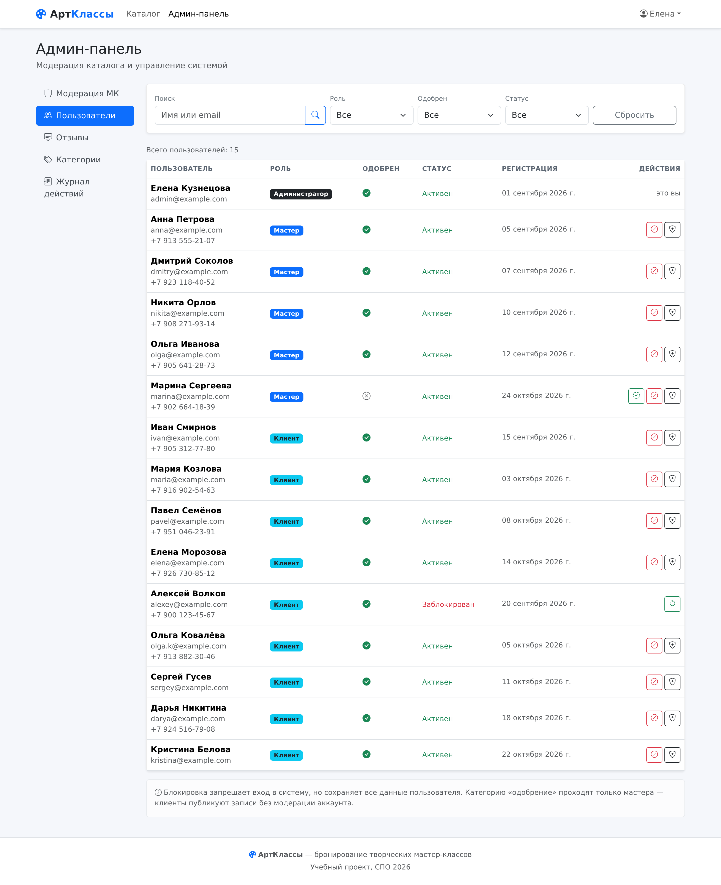

### 8.13. Админ-панель: вкладка «Категории»

Справочник категорий: добавление, редактирование и удаление (с подтверждением). Категорию нельзя удалить, пока к ней привязан хотя бы один мастер-класс — сервер вернёт ошибку, и она показывается уведомлением.

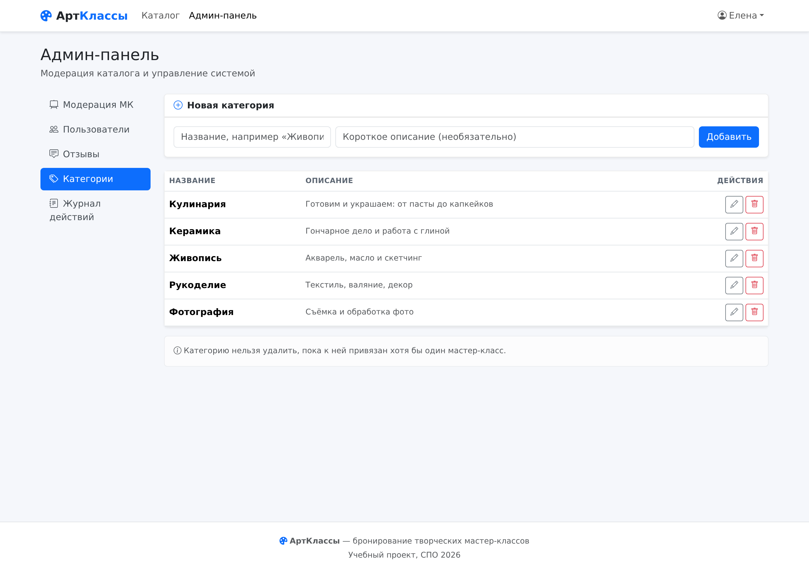

### 8.14. Админ-панель: вкладка «Отзывы»

Модерация отзывов: фильтры «все / только видимые / только скрытые». Действия: скрыть отзыв или вернуть его в каталог. Скрытые отзывы не участвуют в расчёте рейтинга мастера.

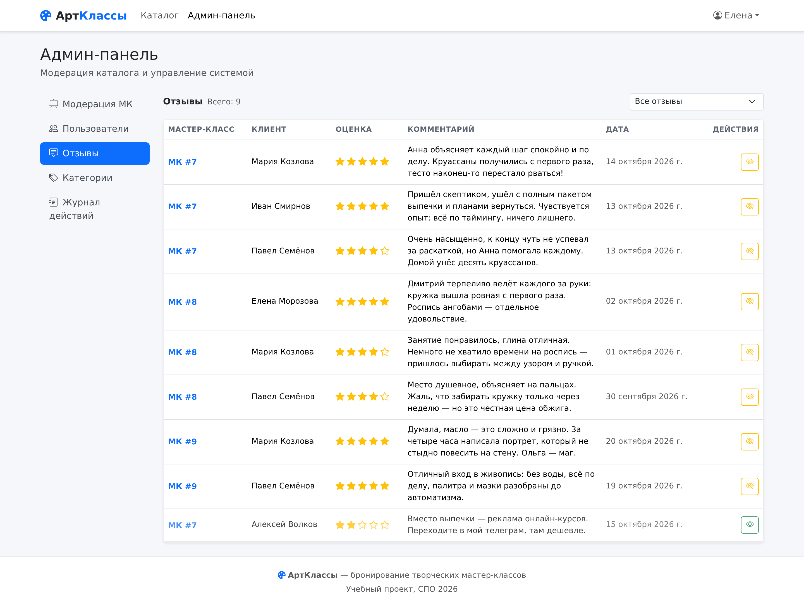

### 8.15. Админ-панель: вкладка «Журнал действий»

Журнал аудита: кто, когда и что сделал. Фильтры: тип сущности (мастер-класс, бронь, пользователь, отзыв, категория), действие (создание, изменение, одобрение, отклонение, отмена), пользователь и идентификатор объекта.

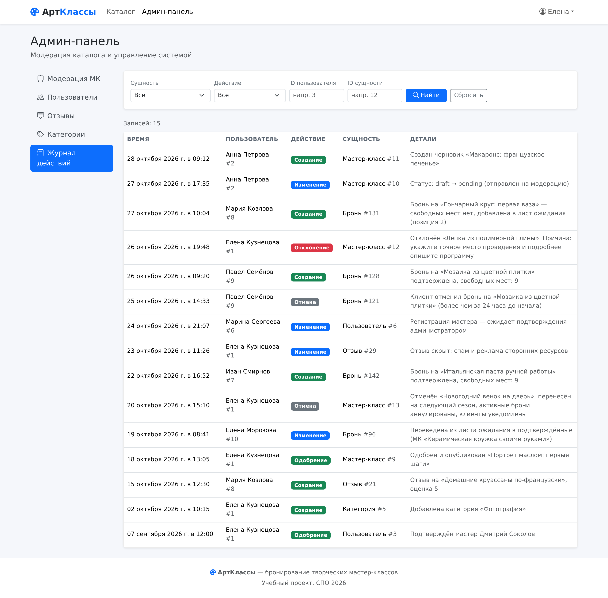


## 9. Фронтенд

Клиентская часть системы — одностраничное веб-приложение (SPA) на React, работающее с бэкендом по REST API. Исходный код находится в папке `front/`: на каждом маршруте рендерится только нужная страница, данные подгружаются напрямую из FastAPI.

### 9.1. Технологии

| Компонент | Технология |
| --- | --- |
| Язык | JavaScript (ES2022), разметка JSX |
| Библиотека UI | React 18 |
| Компоненты интерфейса | Bootstrap 5 + react-bootstrap 2 |
| Иконки | Bootstrap Icons |
| Маршрутизация | react-router-dom 6 |
| Запросы к API | axios 1 (интерцепторы для JWT) |
| Стили | Bootstrap 5 + собственная тема `src/styles/theme.css` (CSS-переменные) |
| Сборка | Vite 5 |
| Окружение запуска | Node.js 20, Docker (сборка `node:20-alpine` → раздача `nginx:1.27-alpine`) |

Дополнительных библиотек для состояния и форм не используется: состояние хранится в хуках React и Context (AuthContext, ToastContext), валидация форм написана вручную.

### 9.2. Структура проекта

```
front/
├── index.html                  — HTML-шаблон SPA
├── vite.config.js              — конфигурация сборки; проксирование /api в dev-режиме
├── Dockerfile                  — двухэтапная сборка образа (node → nginx)
├── nginx.conf                  — статика, SPA-маршруты, проксирование /api на бэкенд
├── package.json
└── src/
    ├── main.jsx                — точка входа: подключение Bootstrap, иконок и темы
    ├── App.jsx                 — маршруты и провайдеры (Auth, Toast)
    ├── api/
    │   ├── client.js           — axios: базовый URL, JWT-интерцепторы, разбор ошибок
    │   └── api.js              — методы API: авторизация, каталог, брони, отзывы, админ
    ├── context/
    │   ├── AuthContext.jsx     — текущий пользователь, вход и выход
    │   └── ToastContext.jsx    — всплывающие уведомления
    ├── components/
    │   ├── ProtectedRoute.jsx  — защита маршрутов по авторизации и роли
    │   ├── layout/             — Navbar (меню зависит от роли), Footer
    │   ├── ui/                 — ConfirmModal, EmptyState, ErrorAlert, Loading,
    │   │                         Pagination, RatingInput, RatingStars, StatusBadge
    │   └── workshop/           — WorkshopCard, ReviewsList
    ├── pages/                  — общие и клиентские экраны
    │   ├── master/             — кабинет мастера
    │   └── admin/              — админ-панель (5 вкладок)
    ├── styles/theme.css        — цвета, бейджи, фиксы нативных элементов форм
    └── utils/                  — constants.js (статусы, роли), format.js (даты, цена, ФИО)
```

### 9.3. Экраны и маршруты

| Маршрут | Экран | Доступ |
| --- | --- | --- |
| `/` | Каталог мастер-классов | все, включая неавторизованных |
| `/workshops/:id` | Карточка мастер-класса | все, включая неавторизованных |
| `/masters/:id` | Профиль мастера | все, включая неавторизованных |
| `/login` | Вход | неавторизованные |
| `/register` | Регистрация | неавторизованные |
| `/my-bookings` | Мои записи | `client` |
| `/profile` | Профиль | все авторизованные |
| `/master/workshops` | Мои мастер-классы | `master` |
| `/master/workshops/new` | Создание мастер-класса | `master` |
| `/master/workshops/:id/edit` | Редактирование мастер-класса | `master` |
| `/master/workshops/:id/participants` | Участники мастер-класса | `master` |
| `/admin/workshops` | Админ-панель: мастер-классы | `admin` |
| `/admin/users` | Админ-панель: пользователи | `admin` |
| `/admin/categories` | Админ-панель: категории | `admin` |
| `/admin/reviews` | Админ-панель: отзывы | `admin` |
| `/admin/logs` | Админ-панель: журнал действий | `admin` |

Маршруты, требующие входа, обёрнуты в компонент `ProtectedRoute`: неавторизованный пользователь направляется на страницу входа, пользователь с «чужой» ролью — на главную. Несуществующий адрес открывает страницу 404.

### 9.4. Аутентификация и права

* Вход выполняется через `POST /api/auth/login` (email и пароль); сервер возвращает JWT-токен и данные пользователя.
* Токен (`ac_token`) и профиль пользователя (`ac_user`) хранятся в `localStorage`, поэтому сессия сохраняется после перезагрузки страницы.
* Axios-интерцепторы: перед каждым запросом подставляется заголовок `Authorization: Bearer <токен>`; при ответе `401` (кроме самих запросов входа и регистрации) сессия очищается, и пользователь перенаправляется на `/login?expired=1` с предупреждением о необходимости войти заново.
* Разграничение доступа на клиенте выполняют `ProtectedRoute` и условный рендеринг меню и кнопок по роли; фактическая защита данных обеспечивается бэкендом — проверкой роли из токена в каждом запросе.

### 9.5. Общий дизайн

Интерфейс выдержан в классическом стиле Bootstrap: основной синий `#0D6EFD`, фон страницы `#F5F7FB`, белые карточки со скруглением 0.375rem и мягкой тенью, светлая шапка с тонкой нижней границей.

**Бейджи статусов** (компонент `StatusBadge`): мастер-класс — «Черновик» (серый), «На модерации» (жёлтый), «Опубликован» (зелёный), «Отклонён» (красный), «Отменён» (тёмный), «Завершён» (голубой); бронь — «Подтверждена» (зелёный), «Лист ожидания» (жёлтый), «Отменена» (серый); роли — «Клиент» (голубой), «Мастер» (синий), «Администратор» (тёмный).

**Обратная связь и UX:**

* тосты об успехе и ошибках всех действий;
* модальные подтверждения опасных операций (отмена брони, отклонение и отмена мастер-класса, блокировка, удаление категории);
* заглушки пустых списков с подсказками (например, «Создайте первый мастер-класс…»);
* спиннеры загрузки и предупреждающие панели;
* ошибки API выводятся человекочитаемо: разбирается поле `detail` из ответа FastAPI, включая массив ошибок валидации;
* клиентская валидация форм до отправки (обязательные поля, формат email, пароль от 8 символов).

**Особенность:** нативные выпадающие списки принудительно переведены в светлую цветовую схему (`color-scheme: light`, `appearance: base-select`) — интерфейс одинаково выглядит при светлой и тёмной теме операционной системы, выпадающие списки всегда читаемы.

**Формат дат:** даты и время вводятся в российском формате — текстовые поля с маской ввода (дд.мм.гггг, чч:мм) и проверкой корректности (несуществующая дата подсвечивается и блокирует отправку). Нативные поля `type="date"` и `type="datetime-local"` не используются: их формат отображения жёстко задаётся локалью браузера и в английской сборке выглядит как mm/dd/yyyy. Перед отправкой даты конвертируются в формат API (гггг-мм-дд и гггг-мм-ддTчч:мм).

**Адаптивность:** сетка Bootstrap перестраивает карточки каталога (от одной до трёх колонок), панель фильтров на узких экранах складывается, широкие таблицы прокручиваются по горизонтали.

### 9.6. Запуск

```
cd front
npm install
npm run dev        # http://localhost:5173 (запросы /api проксируются на http://localhost:8000)
npm run build      # production-сборка в папку dist
```

Запуск всего проекта целиком: `docker compose up --build`. Фронтенд поднимается на `http://localhost:3000`: nginx отдаёт статику и проксирует `/api` на сервис `back:8000` — фронтенд и API работают на одном origin, и CORS не требуется. `index.html` не кэшируется (после деплоя браузер сразу получает новую версию), статические файлы с хешами в имени кэшируются на 7 дней.

Адрес API можно переопределить переменной `VITE_API_BASE_URL` (по умолчанию `/api`), а порт локального бэкенда для проксирования в dev-режиме — `VITE_PROXY_TARGET`.
